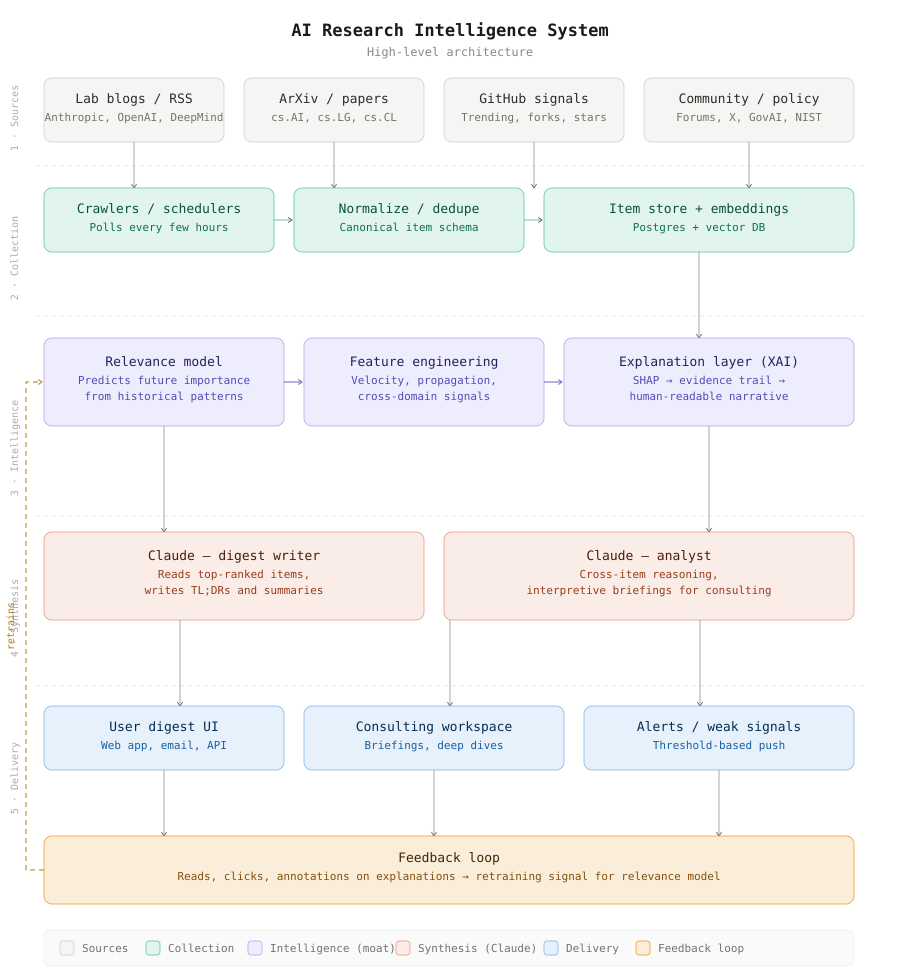

# AI Research Intelligence System — High-Level Architecture

A reference document for the system architecture discussed.

---

## Overview

A five-layer architecture for an AI research intelligence platform. The system separates **data collection** from **intelligence** from **synthesis** from **delivery**, with a feedback loop that lets the intelligence layer compound over time.

The architecture serves two product surfaces from the same infrastructure:
- A **SaaS digest product** for individual researchers and practitioners
- A **consulting practice** delivering interpretive intelligence to enterprises, startups, investors, and policy bodies

---

## The Five Layers

### 1. Sources

Primary data inputs. No transformation happens here — these are dumb pipes that produce raw items.

- **Lab blogs / RSS** — Anthropic, OpenAI, DeepMind, Meta AI, smaller labs
- **ArXiv / papers** — filtered by category (cs.AI, cs.LG, cs.CL) and increasingly by topic embedding
- **GitHub signals** — trending repos, fork velocity, commit activity from credible accounts
- **Community** — forums (Alignment Forum, LessWrong), social signal (X, Discord), policy sources (EU AI Act, NIST, GovAI)

The breadth here is deliberate — the model needs cross-domain signal to detect when an idea is propagating across communities.

### 2. Collection & Storage

Structured data ingestion, deduplication, and storage. **No LLM involvement at this stage.**

- **Crawlers / schedulers** — poll every few hours, handle rate limits and retries
- **Normalize / dedupe** — convert all sources to a canonical item schema (title, body, authors, date, source, URL, raw signals)
- **Item store + embeddings** — Postgres for structured data, vector DB for semantic search and clustering

Why this matters: keeping collection cheap and LLM-free means you can scan thousands of items per day without significant cost. The expensive operations only happen on items that pass the relevance filter.

### 3. Intelligence Layer (the strategic moat)

This is where defensibility lives. Three components:

- **Relevance model** — predicts which items will matter based on early signals. Trained on historical data. Outputs a relevance score plus feature attributions.
- **Feature engineering** — the inputs that feed the model: citation velocity, cross-lab author overlap, propagation patterns through specific communities, cross-domain co-occurrence, source credibility chains
- **Explanation layer (XAI)** — translates raw model outputs (e.g., SHAP values) into evidence-backed human narratives that experts find credible

Key design decision: the relevance model is **infrastructure, not the product**. Users never see scores directly. They experience the model's effects through better digests, earlier alerts, and surfacing of weak signals.

### 4. Synthesis

Claude operates here, in two distinct roles:

- **Claude as digest writer** — high-volume summarization. Reads top-ranked items, produces TL;DRs, classifies by type, generates concise summaries. Cheap per call, runs frequently.
- **Claude as analyst** — cross-item reasoning. Used for consulting deliverables: interpretive briefings, strategic analyses, "what does this mean for X" questions. More expensive per call, runs on demand.

Splitting these matters because they have different cost profiles, different prompts, and serve different revenue streams.

### 5. Delivery

The surfaces users actually touch:

- **User digest UI** — web app, email, API for individual researchers
- **Consulting workspace** — briefings, deep dives, custom reports for enterprise clients
- **Alerts / weak signals** — threshold-based push for high-conviction or anomalous items

### Feedback loop (cross-cutting)

Every interaction at the delivery layer — reads, clicks, dwell time, annotations on explanations — flows back as training signal for the relevance model.

This is what makes the system compound. The model gets better the more it's used, which is why early user behavior is so valuable.

---

## Strategic Notes

**Why infrastructure, not product, for the relevance model.** When the model is the product, buyers stress-test it, benchmark it, demand methodology transparency. When it's infrastructure, the difference is *experienced* rather than evaluated — users just notice the digest is consistently ahead of the curve. Much harder to challenge or replicate.

**Why two Claude roles.** The digest writer is volume. The analyst is judgment. Treating them as one mode either over-pays for routine summaries or under-delivers on interpretive work. Separating them lets each be optimized independently.

**Why the consulting workspace is a peer, not bolted on.** Same infrastructure powers both products. Investments in collection, the relevance model, and explanations compound across SaaS and consulting revenue. This is the path used by Gartner, Forrester, and similar firms — high-touch consulting first, productize the repeatable parts as the model and infrastructure mature.

**Why explainability is a feature, not a debug tool.** Expert users distrust black boxes. An evidence-backed explanation does three things: builds trust during the cold start phase, generates richer feedback (users can flag *why* something is wrong, not just that it's wrong), and creates a defensible product experience that pure ranking systems can't match.

**The hardest cross-cutting concerns** (not in the diagram but real):
- *Identity and reputation* — once the system uses community signal, *who* signals matters as much as *what*. Pseudonymous identity with reputation scoring becomes important.
- *Validation of explanations* — explanations of bad predictions are worse than no explanation. Sample-based human review is the current best practice.
- *Reflexivity* — once the system is trusted, users will conform to or game its outputs. The model needs continuous retraining and probably some form of randomization to keep signal fresh.

---

## Build Order (suggested)

If building this from scratch, the order that makes sense:

1. **Layers 1, 2, and a basic version of 4** — get the digest tool working with simple keyword/topic filters and Claude as the synthesizer. This is roughly the React app version we discussed earlier.
2. **Replace keyword filtering with a basic relevance model** — even a simple embedding similarity + recency weighting gets you most of the way there. Start collecting feedback signal immediately.
3. **Run consulting engagements using the early system** — these are the highest-signal way to learn what the analyst role actually needs to do well.
4. **Build out the explanation layer** — once the relevance model has enough data and feedback to be worth explaining.
5. **Add weak signal detection and longitudinal tracking** — the most ambitious features, requiring the most accumulated data.

The first version doesn't need most of this. The architecture is the destination, not the starting point.
